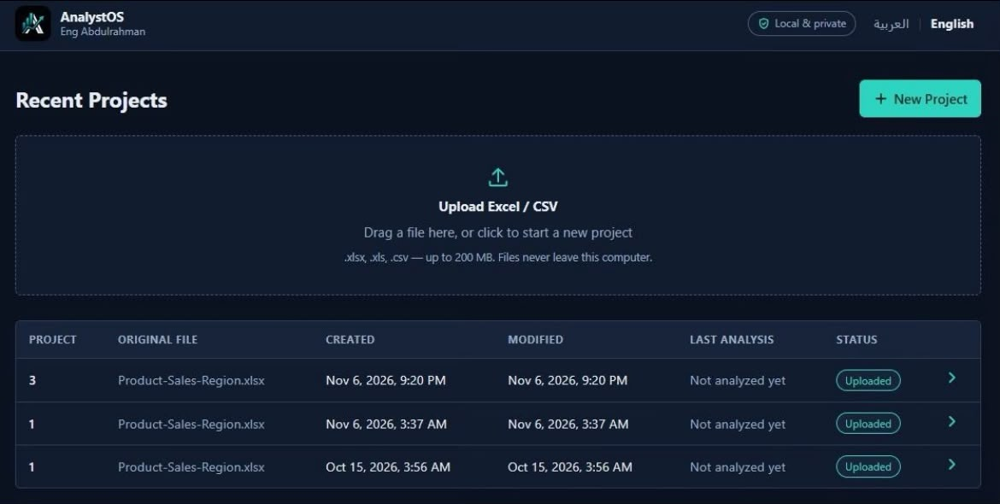
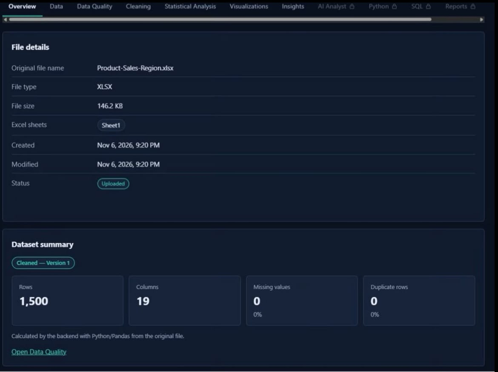
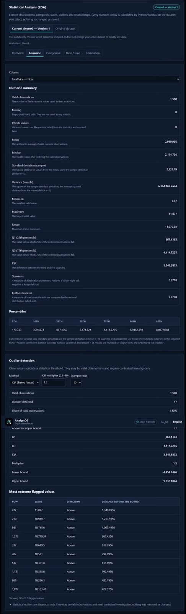
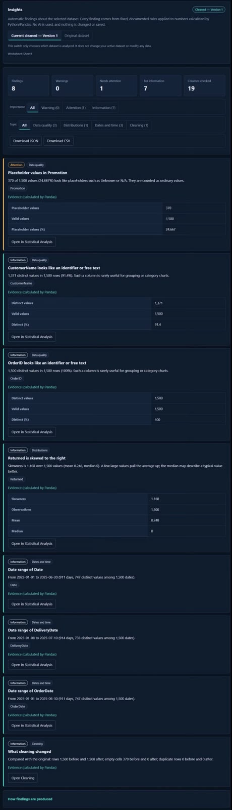

# AnalystOS

### A Private, Local-First Data Analysis Platform

**AnalystOS** is a locally hosted data analysis platform designed to support the data analysis workflow — from uploading and understanding datasets to cleaning, statistical exploration, visualization, and generating evidence-based insights.

The project focuses on data privacy, analytical accuracy, and reproducibility.

---

## Overview

AnalystOS provides a unified workspace for working with CSV and Excel datasets without requiring users to upload their data to an external cloud service.

Its goal is to make data analysis more organized, understandable, and reproducible through a single local application.

## Core Principle

> **Python computes the numbers. AI explains the evidence.**

Analytical calculations are performed by Python. AI explanations are designed to interpret computed results rather than invent metrics or statistical findings.

## Key Features

- **Project Management:** Create and organize independent analysis projects.
- **Data Import:** Upload CSV and Excel datasets.
- **Data Quality Assessment:** Identify missing values, duplicates, and potential data quality issues.
- **Data Cleaning:** Apply cleaning operations while preserving the original dataset and supporting cleaning versions.
- **Exploratory Data Analysis (EDA):** Explore descriptive statistics, distributions, correlations, and outliers.
- **Data Visualization:** Build charts to explore patterns and relationships.
- **Evidence-Based Insights:** Generate findings from calculated analytical results.
- **Project History:** Track important project activities and changes.
- **Bilingual Interface:** Arabic and English support with RTL/LTR layouts.

## Application Screenshots

### 1. Project Creation

### 2. Project Overview

### 3. Exploratory Data Analysis (EDA)

### 4. Evidence-Based Insights

## Technology Stack

| Area | Technologies |
|---|---|
| Backend | Python, FastAPI |
| Data Analysis | Pandas, NumPy, SciPy |
| Frontend | React, TypeScript, Vite |
| Database | SQLite |
| Data Formats | CSV, Excel |

## Privacy & Architecture

AnalystOS is designed around local data processing and privacy:

- Designed for local execution.
- Dataset processing takes place locally.
- Original uploaded files are preserved.
- Analytical calculations are performed by Python.
- AI explanations are designed to rely on computed evidence rather than invented metrics.

## Project Status

AnalystOS is actively in development.

New capabilities, testing, and improvements are being introduced incrementally.

## Developer

**Abdulrahman Alharthi**

Computer Engineering Graduate | Aspiring Data Analyst

GitHub: [@Alharthi-Abdulrahman](https://github.com/Alharthi-Abdulrahman)

---

  <strong>AnalystOS</strong> 
  <em>Understand your data. Discover meaningful insights.</em>

